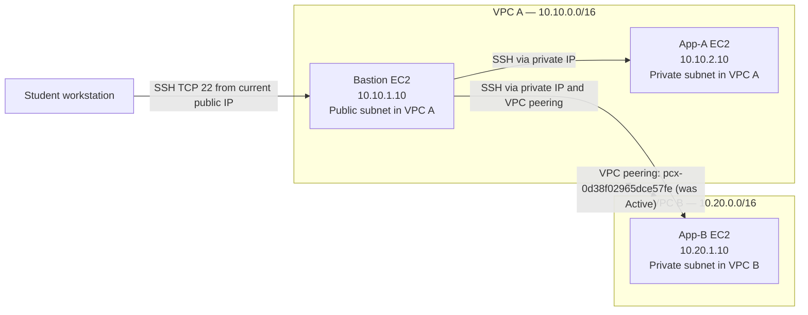

# AWS VPC Peering Lab

**Project:** AWS VPC Peering with Bastion Host and Private-Subnet Connectivity  
**Student:** Anas A Jaweed Darzi  
**AWS Region used:** Asia Pacific (Sydney) — `ap-southeast-2`  
**Status:** Lab completed; lab resources cleaned up after evidence collection.

## Overview

This lab demonstrates private IPv4 connectivity between two Amazon VPCs using VPC peering, with a Bastion host as the SSH entry point. The work included VPC/subnet setup, route-table configuration, security-group rules, SSH access, ICMP validation in both directions, a controlled security-group failure, and recovery testing.

## Architecture

> The architecture represents the completed lab design. The lab resources were deleted after evidence collection, so the IDs and connection state above are historical lab details, not live resources.

## Network inventory

| Resource | Name | CIDR / details |
|---|---|---|
| VPC A | `ewb-vpc-a` | `10.10.0.0/16` |
| VPC A public subnet | `ewb-a-public` | `10.10.1.0/24` |
| VPC A private subnet | `ewb-a-private` | `10.10.2.0/24` |
| VPC B | `ewb-vpc-b` | `10.20.0.0/16` |
| VPC B private subnet | `ewb-b-private` | `10.20.1.0/24` |
| VPC A public route table | `ewb-rt-a-public` | Default route to IGW; VPC B CIDR routed through peering |
| VPC A private route table | `ewb-rt-a-private` | VPC B CIDR routed through peering |
| VPC B private route table | `ewb-rt-b-private` | VPC A CIDR routed through peering |
| Internet Gateway | `ewb-igw-a` | Attached to VPC A during the lab |
| Peering connection | `ewb-vpc-a-to-b` | `pcx-0d38f02965dce57fe`; Active during validation |
| Bastion | `ewb-bastion` | Private IP `10.10.1.10`; public IP was assigned during the lab |
| App-A | `ewb-app-a` | Private IP `10.10.2.10`; no public IPv4 |
| App-B | `ewb-app-b` | Private IP `10.20.1.10`; no public IPv4 |

## Route-table entries

| Route table | Destination | Target |
|---|---|---|
| `ewb-rt-a-public` | `10.10.0.0/16` | `local` |
| `ewb-rt-a-public` | `0.0.0.0/0` | Internet Gateway |
| `ewb-rt-a-public` | `10.20.0.0/16` | VPC peering connection |
| `ewb-rt-a-private` | `10.10.0.0/16` | `local` |
| `ewb-rt-a-private` | `10.20.0.0/16` | VPC peering connection |
| `ewb-rt-b-private` | `10.20.0.0/16` | `local` |
| `ewb-rt-b-private` | `10.10.0.0/16` | VPC peering connection |

## Security-group intent

- `ewb-sg-bastion`: SSH TCP/22 allowed from the student's current public IP `/32`.
- `ewb-sg-app-a`: SSH TCP/22 from Bastion private IP `10.10.1.10/32`; ICMPv4 Echo Request from App-B `10.20.1.10/32`.
- `ewb-sg-app-b`: SSH TCP/22 from Bastion private IP `10.10.1.10/32`; ICMPv4 Echo Request from App-A `10.10.2.10/32`.

The Bastion source IP was set to the workstation's public IP at the time of the lab. Avoid copying an old IP allow-list value into a new deployment without verifying the current address.

## Validation results

- SSH to Bastion: successful.
- SSH to App-A through Bastion: successful.
- SSH to App-B through Bastion: successful.
- App-A → App-B ICMP: 4 packets transmitted, 4 received, 0% loss.
- App-B → App-A ICMP: 4 packets transmitted, 4 received, 0% loss.
- Controlled failure: App-A → App-B ICMP failed while App-B's inbound ICMP Echo Request rule was temporarily removed (4 transmitted, 0 received, 100% loss).
- Recovery: ICMP succeeded again after restoring the rule (4 transmitted, 4 received, 0% loss).

**Evidence note:** A baseline test captured before peering was not recorded. The failure evidence documents the deliberate security-group rule removal after the peering setup, not a pre-peering baseline.

## Evidence and report

- `report/Anas_A_Jaweed_Darzi_EWB_VPC_Peering.pdf` — final report with the evidence appendix.
- `evidence/` — 13 screenshots from the completed lab.

## Cleanup

After collecting evidence, the three EC2 instances were terminated; the VPC peering connection, custom route tables, subnets, Internet Gateway, and both lab VPCs were deleted. The Sydney region checks showed no EBS volumes, snapshots, Elastic IPs, or network interfaces remaining. The only security group shown afterward was the default group for a separate VPC, which was left untouched.

## Security note

This repository intentionally does **not** include SSH private keys, AWS access keys, passwords, or other credentials. Never commit `.pem` files or AWS credentials to GitHub.
